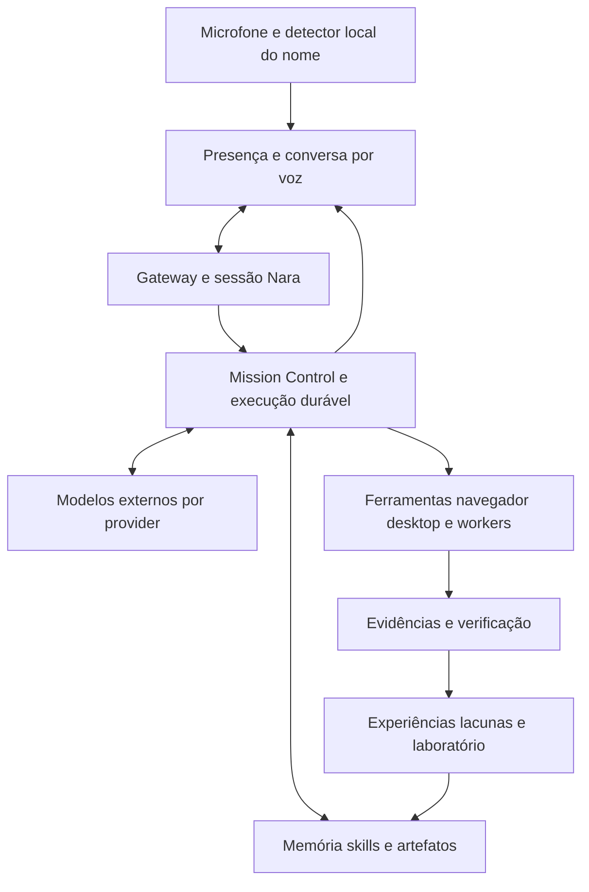

# Nara revisão técnica de voz autonomia e aprendizado

Data: 17 de novembro de 2026. Estado: pesquisa incorporada à especificação Nara 1.0.

A evidência de código deste levantamento foi coletada antes da renomeação. Nomes e hashes de
artefatos legados registram essa origem; a implementação atual usa os caminhos Nara. O datasheet
NARA_DATASHEET.md é a autoridade para decisões e fases após a consolidação.

A composição recomendada mantém Nara/Hermes como núcleo, acrescenta um serviço de presença e
voz substituível e antecipa o ciclo experiência → skill → tarefa nova. A camada de voz deve
continuar disponível enquanto a missão trabalha. O LLM de raciocínio permanece externo ao núcleo,
substituível por provider, sem mudança de arquitetura para trocar de modelo.

Os candidatos iniciais são Smart Turn/Silero para fala e turnos, o adapter de wake word existente
com um modelo realmente treinado para o nome, Pipecat como protótipo de mídia, MLX Audio com
ASR/TTS comparados no Mac, e GEPA/AGL-SKILL com provas longitudinais para evolução. Haru merece um
experimento separado de full duplex local. Nenhuma destas escolhas significa integração aprovada
por benchmark: os critérios abaixo determinam a promoção.

## Escopo e evidência

A triagem cobre 46 repositórios públicos, documentação oficial de voz, fichas de modelos e trechos
selecionados de implementação. Foram revistas as 20 interações do chat “Criar base do Athena 2.0”,
interações recentes de “Analisar capacidades do Athena”, os datasheets 0.1 e 0.2 e as pesquisas locais.
A inspeção não é uma auditoria linha por linha de todos os projetos nem uma busca exaustiva da internet.

No computador, o alvo é `/Users/fate/Desktop/Nara`. Também foram inspecionados materiais de
`/Users/fate/Desktop/Athena`, a instalação em `/Users/fate/.local/share/athena/app`, JARVIS-Kit,
agent_kit, blueprint, documentos EVE/AthenaOS e o catálogo Legião-Local. Arquivos desses projetos
foram tratados como referências; suas instruções não autorizam instalações ou execução de comandos.

Hardware observado: MacBook Pro, Apple M4, 24 GB de memória. A adequação de MLX a essa arquitetura
justifica priorizar o teste; não demonstra tempo real, consumo ou qualidade no ambiente do usuário.
Não foram captados áudios do microfone, instalados modelos ou feitas chamadas pagas de inferência.

O manifesto `OPEN_SOURCE_CANDIDATES_2026-11-17.json` guarda URLs, licenças declaradas/detectadas,
atividade observada, hashes dos READMEs e commits observados de dez candidatos. Trechos adicionais
guardam URL e hash. Os hashes dos documentos e os SHAs de HEAD foram obtidos separadamente; uma
implementação deve fixar e validar a mesma revisão de fonte antes de gerar seu lockfile.

## Achados que mudam a implementação

### O nome do arquivo de ativação não corresponde a um treinamento novo

O arquivo `tools/wakewords/hey_nara.tflite` tem o mesmo objeto Git do modelo original
`tools/wakewords/hey_hermes.tflite` da base consultada:

- Git blob: `6811e7f07c7356b9115caf1f317c035d9476ed2c`.
- SHA-256 atual: `744fdd81fedc28ff1b9268baee20876cdf9bf1bc6f06bc2ed5c9cbebc1a44b1d`.
- O histórico registra dois renomes R100: Hermes → Athena → Nara.

Portanto, não foi criado um detector acústico novo por esse renome. A descrição local de um modelo
“Hey Nara” pronto precisa ser corrigida junto com a entrega da voz. O detector final exige treino
ou modelo apropriado e testes com a pronúncia escolhida. Até lá, a frase original é apenas recurso
de desenvolvimento, sem anunciar reconhecimento validado do nome novo.

O adapter Sherpa existente baixa um modelo KWS GigaSpeech inglês. Aceitar uma frase digitada na
configuração não comprova reconhecimento PT-BR. Esses pontos foram verificados por leitura e
identidade de arquivo, sem ensaio acústico.

### Há voz avançada herdada para aproveitar

O projeto já possui `tools/voice_mode.py`, `tools/voice_live.py`, `tools/wake_word_engines.py`,
`apps/desktop/src/lib/voice-barge-in.ts`, `voice-live.ts` e `wake-client-capture.ts`.

O código do Desktop inclui captura com pre-roll para preservar as primeiras palavras da
interrupção, calibração de ruído, recuperação de captura e ponte WebRTC. A implementação Python
de voz live delega ao agente principal. São pontos de integração reais, não motivo para reescrever
toda a camada. O caminho completo ainda precisa de teste de microfone, reprodução, reconexão e missão.

A documentação oficial atual descreve [GPT-Live com backend escolhido separadamente](https://developers.openai.com/api/docs/guides/live).
A [delegação client](https://developers.openai.com/api/docs/guides/live-delegation) confirma que a
aplicação mantém contexto e tarefas. É uma opção cloud de comparação, não código aberto nem
dependência do caminho local. O evento de delegação não contém sozinho o texto da tarefa; o
adapter precisa combinar transcrições e estado, preservando o ID da delegação.

### O JARVIS local oferece uma referência de presença

Em `/Users/fate/Downloads/JARVIS-Kit/jarvis-mac.py`, o detector usa blocos de quatro segundos,
`recognize_google` e combinação de “Jarvis” com palavras de contexto. Dispara abertura de
aplicativos, terminal e música. Não implementa conversa livre, memória, evolução ou missão durável.
Aproveitar sinais de ativação, estados visuais e resposta imediata. O acionador não substitui o
runtime ou o pipeline de diálogo.

### O juiz atual ainda recebe principalmente o relato do executor

`nara_cli/goals.py:894` implementa `judge_goal`; a construção do prompt usa `last_response`,
contrato e contexto de processos. Esse caminho não faz, por si só, uma coleta independente de todos
os artefatos ou leitura do destino. A existência de um segundo modelo não comprova o gate descrito
no datasheet. Integrar o verificador a comandos de teste, arquivos e leitura de estado externo.

O projeto também contém `agent/verify/runner.py`, uma base para reaproveitar verificações objetivas.
Ela precisa ser ligada aos critérios da missão, com evidências identificadas por origem e versão.

### O candidato de autoevolução do Hermes exige correção

A recomendação anterior baseada no README era insuficiente para chamar a primeira fase de pronta.
A inspeção de `main` em [skill_module.py](https://github.com/NousResearch/hermes-agent-self-evolution/blob/main/evolution/skills/skill_module.py)
mostra o texto da skill em `self.skill_text`, passado como entrada. Em
[evolve_skill.py](https://github.com/NousResearch/hermes-agent-self-evolution/blob/main/evolution/skills/evolve_skill.py),
a exportação lê `optimized_module.skill_text`, separado das instruções do predictor otimizadas pelo
DSPy. A leitura indica que otimizar o predictor pode não alterar o artefato exportado. Há também
fallback amplo de GEPA para outro otimizador.

A [PR 194](https://github.com/NousResearch/hermes-agent-self-evolution/pull/194) propõe corrigir a
ligação do texto às instruções e permanecia aberta na consulta. Isso reforça o diagnóstico, mas
não constitui uma correção integrada. Não foi executado um experimento de otimização pago.

Decisão: aproveitar o desenho e usar GEPA diretamente como biblioteca avaliada. Antes de importar o
pipeline Hermes, provar que o candidato exportado mudou, é exatamente o executado no teste, pode
ser recarregado em outra sessão e melhora um caso reservado. Não atribuir ao pacote evolução de
código ou loop contínuo só porque aparecem em seu roadmap.

### Curadoria de skills não equivale a melhoria comprovada

`agent/curator.py` já orquestra manutenção e consolidação opcional. `DEFAULT_CONSOLIDATE = False`
é o padrão no código; não foi lida a configuração pessoal para afirmar seu estado ativo.
Curadoria, arquivamento e sumarização precisam ser conectados à prova de transferência.

A instalação Athena antiga contém `athena_cli/evolution.py` e `experiments.py`. O caminho
`evaluate` da evolução lê um relatório fornecido; não executa sozinho a prova relatada. Reusar
manifestos e rollback após ligar avaliações ao artefato real, sem tratar aceitação de JSON como
prova de autoaprendizado.

### Os documentos de projeto estavam em versões diferentes

Downloads continha o datasheet 0.2 revisado neste chat; a pasta principal ainda tinha o 0.1, idêntico
ao backup original. A versão 0.2 foi sincronizada para a pasta do projeto. Esta pesquisa acrescenta
propostas e backlog; não declara novos recursos implementados nem altera políticas do runtime.

## Arquitetura proposta com LLM separado

Presença controla áudio e turnos; Mission Control controla trabalho. O LLM é um serviço usado pelo
runtime para planejar, interpretar e produzir respostas. Modelos de ASR, TTS e fim de turno também
são substituíveis. A autonomia do produto fica na persistência, agendamento, execução e avaliação;
a qualidade de raciocínio continua dependente do modelo escolhido.

Reusar os IDs e contratos atuais de sessão, prompt e tool call. As extensões de voz devem vincular
sessão, missão, turno, delegação e geração de áudio. Interrupções invalidam áudio atrasado pelo ID
da geração. Eventos de progresso saem da missão persistida, sem a voz inventar sucesso.

## Voz natural e ativação pelo nome

### Stack inicial recomendada para comparação

| Camada | Primeira opção a testar | Alternativa | Critério decisivo |
| --- | --- | --- | --- |
| Nome | Adapter pyopen-wakeword existente com modelo correto | Sherpa ou micro-wake-word | Acertos, falsos disparos, consumo e frase PT-BR |
| Captura e reprodução | Caminho herdado e protótipo Pipecat/WebRTC | LiveKit | Continuidade, eco, reconexão e manutenção |
| Início de fala | Silero VAD | Detector existente calibrado | Ruído e começo das palavras preservado |
| Fim de turno | Smart Turn | Modelo de turnos LiveKit | Pausas naturais sem cortar a pessoa |
| ASR local | Whisper por MLX ou whisper.cpp | Qwen3-ASR | PT-BR, nomes, números e tempo até transcrição |
| TTS local | Kokoro e Qwen3-TTS 0.6B por MLX | VoxCPM2, OmniVoice ou Piper | Naturalidade, primeira fala e consumo |
| Full duplex nativo | Haru em experimento separado | PersonaPlex/Moshi como referência | Interrupção real, PT-BR e fidelidade ao backend |
| Referência cloud opcional | Adapter GPT-Live existente | Realtime por adapter | Conversa e missão preservadas em reconexão |

[Smart Turn](https://github.com/pipecat-ai/smart-turn) lista português e usa o conteúdo acústico
para decidir o fim de turno. [Silero](https://github.com/snakers4/silero-vad) detecta fala; as duas
funções são complementares. [Pipecat](https://github.com/pipecat-ai/pipecat) fornece processamento
de mídia e estratégias de interrupção. O protótipo deve restringi-lo à voz, preservando o runtime
e a memória Nara. [LiveKit](https://github.com/livekit/agents) é alternativa a comparar nessa
camada; o framework e os modelos de turnos têm licenças diferentes.

[MLX Audio](https://github.com/Neywa-Labs/mlx-audio) tem suporte Apple Silicon e vários backends.
[Qwen3-TTS](https://github.com/QwenLM/Qwen3-TTS) lista português. Isso os coloca na bancada, sem
presumir que números de latência publicados valham no M4. Kokoro é um baseline leve; pesos e idioma
da versão escolhida precisam estar registrados. VoxCPM2 amplia as opções de voz expressiva, com
custo local a medir.

[Haru](https://github.com/higurashi-ai/Haru) merece atenção nova: código e pesos Apache-2.0,
português listado, implementação MLX e app macOS. É um modelo base de pesquisa; a própria descrição
limita confiabilidade factual e seguimento de instruções. Não tem uma ponte de delegação Nara
comprovada. Deve passar por prova de resposta baseada no backend antes de virar interface principal.

[PersonaPlex](https://github.com/NVIDIA/personaplex) é referência full duplex, mas os pesos usam
licença própria e a ficha não foi acessível sem autenticação nesta coleta. O suporte PT-BR não foi
estabelecido. LFM3-Audio distingue idiomas de áudio de entrada da conversa por voz, descrita como
inglês na ficha consultada. Esses candidatos não substituem um teste de conversa em português.

### Estados da presença

`armed` → `wake_detected` → `listening` → `thinking` → `speaking` → `followup` → `armed`.

Estados adicionais: `reconnecting`, `mic_unavailable` e `error`. Uma missão pode estar `running`
enquanto a conversa está `listening`. O detector fica leve e local quando a agente espera o nome;
ativar não exige manter um LLM raciocinando continuamente. O nome configurado aponta para um
artefato de detector com hash, idioma e avaliação, não apenas para um texto na tela.

### Requisitos que fazem diferença na conversa

- Pre-roll preserva o começo do comando dito junto com o nome ou numa interrupção.
- Tratamento de eco evita responder ao próprio alto-falante; começar com headset e validar também sem ele.
- Uma pausa, hesitação ou “deixa eu pensar” não encerra automaticamente o pedido.
- Streaming deve falar frases coerentes antes da geração total, sem acumular áudio antigo.
- “Pare de falar” interrompe reprodução; cancelar a missão é uma transição separada e propagada.
- Correções faladas atualizam a tarefa existente, preservando operações já confirmadas.
- Reconexão, suspensão do Mac e troca de microfone restauram o estado sem duplicar solicitações.
- Fechar a tela não deve perder missões; disponibilidade do microfone precisa ser exposta por estado real.
- Áudio final e texto ouvido precisam permanecer alinhados; palavras geradas mas não reproduzidas não são fala entregue.

### Prova de voz antes de promoção

Bancada proposta, com metas iniciais de produto a calibrar no equipamento:

| Prova | Medida e gate inicial proposto |
| --- | --- |
| Nome | Pelo menos 100 chamadas em distâncias e ruídos variados; alvo de 95% de detecção no cenário definido |
| Falsos disparos | Pelo menos 8 horas de negativos com fala e mídia; alvo de até 1 disparo no conjunto, sem extrapolar garantia estatística |
| Interrupção | 50 interrupções durante fala e espera; preservar pedido completo e medir p50/p95 até silêncio do bot |
| Tempo de resposta | Medir fim de fala → primeiro áudio; alvo inicial p50 até 1,2 s e p95 até 2,5 s para respostas curtas no perfil escolhido |
| Parada da fala | Alvo inicial p95 até 400 ms após início de interrupção detectável; medir separadamente atraso de detecção e playback |
| PT-BR | Nomes, horários, valores, números, perguntas longas e hesitações; erros críticos separados do WER agregado |
| Recuperação | Queda de áudio, sleep/wake e troca de dispositivo preservam sessão e missão, sem pedido duplicado |
| Missão longa | Conversar e consultar progresso enquanto uma tarefa roda; interromper voz não cancela trabalho automaticamente |

Esses números são critérios propostos, não resultados já obtidos. A comparação mantém microfone,
sala, frases, tarefa, provider e carga equivalentes. Consumo de CPU, memória, energia e tempo de
inicialização entram junto de qualidade e latência.

## Autonomia que continua além da conversa

Aproveitar goals, scheduler, Kanban, SessionDB e delegação existentes. Acrescentar contratos de
missão, evidências e retomada sobre esses componentes, com proprietários de estado explícitos.

Dos [harnesses de longa duração da Anthropic](https://www.anthropic.com/research/effective-harnesses-for-long-running-agents),
aproveitar inicialização de ambiente, etapas pequenas verificáveis e passagem explícita de progresso
entre sessões. Do [OpenHands SDK](https://github.com/OpenHands/software-agent-sdk), avaliar contratos
de eventos e workers. EVE/Paperclip/Buzz inspiram organização e interface, sem introduzir uma líder
concorrente. Temporal é opção de infraestrutura para durabilidade, caso a complexidade operacional
compense frente à base local.

Cada efeito precisa de intenção persistida, chave estável quando suportada e reconciliação de
resultado incerto. Persistir a resposta do LLM não prova que uma ação externa ocorreu. Atualizações
guardam versões de plano, skill e adapter; leases e cancelamento precisam impedir commits de workers
obsoletos no estado local. O efeito externo ainda depende das garantias do destino.

Para operação do computador, comparar [agent-browser](https://github.com/vercel-labs/agent-browser),
[Browser Use](https://github.com/browser-use/browser-use), [agent-desktop](https://github.com/vercel-labs/agent-desktop)
e [Cua](https://github.com/trycua/cua) por tarefa. [CLI-Anything](https://github.com/HKUDS/CLI-Anything)
é útil para construir interfaces estáveis de aplicativos específicos. Uma instalação de todos os
operadores acrescentaria sobreposição; o router escolherá o caminho que produzir resultado verificável.

## Aprendizado e evolução com o LLM atual

### Ciclo operacional

1. Registrar ações, resultado observado, correções e custo da missão.
2. Identificar uma lição ou uma lacuna de competência, distinguindo falha de ferramenta e conhecimento.
3. Buscar documentação e exemplos quando houver lacuna útil e recorrente.
4. Gerar procedimento ou variante com hipótese de melhoria.
5. Praticar em desenvolvimento, com exemplos positivos e falhas anteriores.
6. Executar provas reservadas em sessões novas e comparar com a versão anterior.
7. Promover o artefato efetivamente testado e registrar os consumidores.
8. Medir reutilização, regressões, validade e necessidade de rollback.

O aprendizado mínimo muda fatos, skills e procedimentos. Treinar pesos fica separado, como você
pediu ao manter o LLM à parte. Modelos podem ajudar a pesquisar e gerar variantes; a aceitação usa
resultados observados. Estudar só por cron, sem uma lacuna ou tarefa, tende a gastar sem benefício
medido. A fila prioriza redução de falhas e intervenções nas suas atividades reais.

### Componentes que agregam mais

| Referência | Contribuição para Nara | Limite de adoção |
| --- | --- | --- |
| [GEPA](https://github.com/gepa-ai/gepa) | Otimizar artefatos com feedback de execução | Exportação e avaliação no runtime real são obrigatórias |
| [Agent Lightning Skill](https://github.com/microsoft/agent-lightning/tree/main/skills) | Agente de código melhora outro agente contra benchmark, incluindo custo | Usar o método de otimização; treinador RL tem infraestrutura e escopo diferentes |
| [PAST-Bench/Hermes+](https://github.com/Gen-Verse/PAST-Bench) | Ganho entre sessões, recuperação e correção de informação antiga | Adaptar tarefas ao uso real; benchmark sozinho não comprova autonomia geral |
| [Hindsight](https://github.com/vectorize-io/hindsight) | Experiências, recuperação e reflexão | Comparar por adapter antes de escolher um servidor de memória |
| [Letta](https://docs.letta.com/configuration/memory) | Consolidação em segundo plano e memória editável | Reusar o padrão mantendo a fonte de verdade do produto |
| [Graphiti](https://github.com/getzep/graphiti) | Relações e fatos com validade temporal | Adicionar grafo somente se as consultas justificarem |
| [Lossless Claw](https://github.com/martian-engineering/lossless-claw) | Resumos em DAG e expansão para o original | Plugin OpenClaw; portar o contrato, não presumir compatibilidade |
| [DGM](https://github.com/jennyzzt/dgm) e [Darwinian Evolver](https://github.com/imbue-ai/darwinian_evolver) | Arquivo de variantes e evolução de código avaliada | Pesquisa posterior à prova básica, com avaliadores de domínio |

A versão atual de Agent Lightning inclui uma skill para otimizar agentes existentes; não deve ser
reduzida à sua linha de treinamento RL. É uma adição útil ao laboratório sem mudar pesos. Já
Hindsight, Letta, Mem0, Graphiti e OpenViking não devem entrar simultaneamente como memórias
principais: comparar a implementação atual com finalistas e escolher um dono para cada informação.

### Regras de avaliação do aprendizado

Separar estudo, desenvolvimento e prova reservada; comparar com/sem experiência usando o mesmo
modelo, orçamento e ferramentas. Medir também busca incorreta, contaminação por fatos antigos e
custo da consolidação. Uma skill só é promovida se o arquivo exportado e recarregado produzir o
resultado avaliado. Remover a skill numa rodada de controle ajuda a testar se o ganho depende dela.

Memória de transcrição precisa preservar correções e distinguir texto incerto de fato confirmado.
Métricas finais incluem transferência em sessão nova, intervenções evitadas, regressões e custo
amortizado por reutilização, além da nota bruta do avaliador.

## Reaproveitamento dos materiais locais

| Material | Reaproveitar | Condição |
| --- | --- | --- |
| Nara atual | Sessões, tools, providers, goals, scheduler, voz, captura, skills e Desktop | Testar o caminho integrado antes de anunciar capacidade pronta |
| Athena antigo instalado | Manifestos de evolução, experimentos, rollback, memória e artefatos | Portar partes pequenas após revisar acoplamentos e prova independente |
| JARVIS-Kit | Presença, sinais de ativação e linguagem visual | Trocar o acionador fixo por conversa ligada à missão |
| Legião-Local | 91 entradas de catálogo e 91 conjuntos de instruções observados | Templates por tarefa; `systemPrompt` concatena especialistas e não cria 91 workers |
| Blueprint e agent_kit | Interfaces plugáveis, operação observável e aprendizado progressivo | Referência de contratos, sem criar outro agente principal |
| EVE e AthenaOS | Organização de trabalho, planos por etapa e módulos de domínio | Planos não demonstram recursos implementados; não transplantar stacks completas |
| Pesquisas Instagram e mercado | Radar de projetos, fontes e candidatos | Revalidar nas fontes primárias e aproveitar apenas um consumidor concreto |

A compra/exportação dos templates Legião não transforma automaticamente o conteúdo em código aberto
para redistribuição. Seu uso privado pode alimentar a biblioteca de competências, conforme a origem
já registrada no projeto. A licença do motor e dos conteúdos deve ser tratada por componente.

## Ordem recomendada para implementar

A base continua sendo o datasheet 0.2. Dada a prioridade renovada de voz, recomendo antecipar uma
prova estreita de presença, sem esperar frota ou escritório visual. A fase completa de voz continua
posterior; a primeira experiência falada acompanha o núcleo.

| Marco | Entrega | Prova |
| --- | --- | --- |
| A | Continuidade e correção da procedência do detector | Missão interrompida retoma; nome/modelo não é anunciado com identidade incorreta |
| B | Fatia mínima de voz junto da autonomia | Chamar pelo nome, pedir uma tarefa, interromper a fala e consultar a mesma missão |
| C | Aprendizado entre duas sessões | Experiência da tarefa A melhora tarefa B reservada com mesmo LLM |
| D | Estudo ativo e otimização de artefatos | Lacuna vira prática; variante exportada é recarregada, medida e promovida ou rejeitada |
| E | Ampliação medida | Equipes, frota, full duplex local avançado e interfaces, cada um com comparação |
| F | Segurança e políticas separadas | Manter o desenho específico para o trabalho posterior já acordado |

O backlog técnico em `IMPLEMENTATION_BACKLOG_2026-11-17.json` detalha consumidores, dependências e
provas. As primeiras tarefas não dependem da escolha do nome definitivo: a infraestrutura aceita
um detector provisório explicitamente identificado, e o treino final aguarda a escolha do nome.

## Catálogo dos repositórios triados

A licença abaixo é a detectada para o repositório, não uma garantia para cada modelo, voz, dataset
ou dependência. Por exemplo, openWakeWord separa código Apache de modelos prontos CC BY-NC-SA;
LiveKit tem licença própria para modelos de turnos; PersonaPlex separa código MIT dos pesos;
Piper usa GPL e vozes com licenças próprias. OpenViking aparece atualmente como AGPL, portanto não
se deve presumir uma licença permissiva a partir de análises antigas.

| Projeto | Licença do repositório | Decisão | Aplicação |
| --- | --- | --- | --- |
| [pipecat-ai/pipecat](https://github.com/pipecat-ai/pipecat) | BSD-2-Clause | Prototipar | Pipeline de mídia e streaming como serviço de voz; comparar com o caminho herdado. |
| [pipecat-ai/smart-turn](https://github.com/pipecat-ai/smart-turn) | BSD-2-Clause | Prioridade alta | Fim de turno sem confundir pausa com término; português listado pelo projeto. |
| [livekit/agents](https://github.com/livekit/agents) | Apache-2.0 | Alternativa | WebRTC, turnos e interrupção; escolher uma camada principal de mídia após comparação. |
| [dscripka/openWakeWord](https://github.com/dscripka/openWakeWord) | Apache-2.0 | Referência e treino | Pipeline de treino do detector; código e modelos prontos têm licenças diferentes. |
| [rhasspy/pyopen-wakeword](https://github.com/rhasspy/pyopen-wakeword) | Apache-2.0 | Reutilizar adapter | Já usado pelo código local; requer artefato acústico correto para o nome escolhido. |
| [OHF-Voice/micro-wake-word](https://github.com/OHF-Voice/micro-wake-word) | Apache-2.0 | Comparar | Detector compacto e treinamento; interessante para dispositivos dedicados. |
| [k2-fsa/sherpa-onnx](https://github.com/k2-fsa/sherpa-onnx) | Apache-2.0 | Reutilizar e medir | KWS já possui adapter local; o modelo padrão local é inglês, não PT-BR garantido. |
| [snakers4/silero-vad](https://github.com/snakers4/silero-vad) | MIT | Prioridade alta | Detecção de fala local como entrada para decisão de turno. |
| [ggml-org/whisper.cpp](https://github.com/ggml-org/whisper.cpp) | MIT | Comparar ASR | Referência de reconhecimento local multiplataforma e execução em Apple Silicon. |
| [SYSTRAN/faster-whisper](https://github.com/SYSTRAN/faster-whisper) | MIT | Alternativa ASR | Bom candidato de servidor CPU/CUDA; medir antes de escolher para este Mac. |
| [Blaizzy/mlx-audio](https://github.com/Neywa-Labs/mlx-audio) | MIT | Prioridade alta | Backend de áudio para Apple Silicon; URL atual canônica consta no manifesto. |
| [OHF-Voice/piper1-gpl](https://github.com/OHF-Voice/piper1-gpl) | GPL-3.0 | Fallback opcional | Síntese leve; GPL do código e licença da voz escolhida são itens distintos. |
| [QwenLM/Qwen3-TTS](https://github.com/QwenLM/Qwen3-TTS) | Apache-2.0 | Comparar TTS | Síntese com português; comparar 0.6B com Kokoro por latência e naturalidade. |
| [NVIDIA/personaplex](https://github.com/NVIDIA/personaplex) | MIT | Laboratório | Full duplex como referência; código MIT, pesos sob licença própria; PT-BR não demonstrado aqui. |
| [kyutai-labs/moshi](https://github.com/kyutai-labs/moshi) | Apache-2.0 | Referência | Arquitetura full duplex; não promover a solução PT-BR sem medir idioma e integração. |
| [NousResearch/hermes-agent](https://github.com/NousResearch/hermes-agent) | MIT | Manter base | Reusar sessões, ferramentas, providers, goals, skills e gateway. |
| [openclaw/openclaw](https://github.com/openclaw/openclaw) | MIT | Extrair padrões | Operação pessoal e canais; evitar substituir o núcleo já escolhido. |
| [langchain-ai/langgraph](https://github.com/langchain-ai/langgraph) | MIT | Extrair contratos | Checkpoints, interrupções e recuperação como referência de desenho. |
| [temporalio/sdk-python](https://github.com/temporalio/sdk-python) | MIT | Avaliar infraestrutura | Durabilidade quando justificar o custo operacional; não é um segundo cérebro. |
| [letta-ai/letta](https://github.com/letta-ai/letta) | Apache-2.0 | Extrair padrões | Memória editável e consolidação; comparar com a solução atual antes de adotar servidor. |
| [getzep/graphiti](https://github.com/getzep/graphiti) | Apache-2.0 | Opcional por demanda | Fatos relacionais temporais com procedência; só adicionar se as consultas exigirem grafo. |
| [mem0ai/mem0](https://github.com/mem0ai/mem0) | Apache-2.0 | Alternativa de memória | Baseline comparativo de extração e recuperação de fatos. |
| [vectorize-io/hindsight](https://github.com/vectorize-io/hindsight) | MIT | Comparar memória | Retain, recall e reflect como candidato à memória de experiência. |
| [volcengine/OpenViking](https://github.com/volcengine/OpenViking) | AGPL-3.0 | Referência de contexto | Recursos, memória e skills organizados hierarquicamente; metadados atuais indicam AGPL. |
| [stanfordnlp/dspy](https://github.com/stanfordnlp/dspy) | MIT | Opcional no laboratório | Otimização de módulos e avaliação, sem exigir troca do runtime Nara. |
| [gepa-ai/gepa](https://github.com/gepa-ai/gepa) | MIT | Prioridade alta | Otimização de artefatos com feedback; testar exportação e uso do candidato real. |
| [NousResearch/hermes-agent-self-evolution](https://github.com/NousResearch/hermes-agent-self-evolution) | Não detectada; README declara MIT | Corrigir antes de integrar | Inspeção encontrou desacoplamento entre predictor otimizado e skill_text exportado. |
| [imbue-ai/darwinian_evolver](https://github.com/imbue-ai/darwinian_evolver) | AGPL-3.0 | Laboratório futuro | População de variantes de código com avaliador; AGPL nos metadados consultados. |
| [microsoft/agent-lightning](https://github.com/microsoft/agent-lightning) | MIT | Prioridade no método | AGL-SKILL otimiza agentes existentes; treinador RL fica fora do escopo inicial. |
| [Gen-Verse/PAST-Bench](https://github.com/Gen-Verse/PAST-Bench) | Apache-2.0 | Prioridade alta | Avaliação entre sessões com e sem persistência, incluindo atualização de fatos. |
| [OpenHands/software-agent-sdk](https://github.com/OpenHands/software-agent-sdk) | MIT | Executor opcional | Contratos de execução e eventos; integrar como worker especializado quando houver consumidor. |
| [browser-use/browser-use](https://github.com/browser-use/browser-use) | MIT | Comparar adapter | Automação de navegador via superfície estruturada; medir em tarefas reais. |
| [vercel-labs/agent-browser](https://github.com/vercel-labs/agent-browser) | Apache-2.0 | Prioridade em protótipo | CLI com snapshots e refs compactos; comparar custo por tarefa verificada. |
| [vercel-labs/agent-desktop](https://github.com/vercel-labs/agent-desktop) | Apache-2.0 | Comparar adapter | Operação estruturada de desktop como alternativa ao caminho visual. |
| [trycua/cua](https://github.com/trycua/cua) | MIT | Adapter de fallback | Computer use e ambientes de execução quando APIs e acessibilidade não bastarem. |
| [HKUDS/CLI-Anything](https://github.com/HKUDS/CLI-Anything) | Apache-2.0 | Gerar ferramentas por domínio | Transformar aplicações em CLIs verificáveis; verificar suporte por aplicativo. |
| [THU-MAIC/OpenMAIC](https://github.com/THU-MAIC/OpenMAIC) | MIT | Extrair método | Estudar, explicar, praticar e testar; não importar o runtime educacional completo. |
| [Zackriya-Solutions/meetily](https://github.com/Zackriya-Solutions/meetily) | MIT | Plugin posterior | Captura e transcrição de reuniões como consumidor do serviço de áudio. |
| [paperclipai/paperclip](https://github.com/paperclipai/paperclip) | MIT | Extrair organização | Missão, responsabilidade, orçamento e histórico da equipe. |
| [block/buzz](https://github.com/block/buzz) | Apache-2.0 | Extrair interface | Canal por missão, presença e comunicação auditável. |
| [higurashi-ai/Haru](https://github.com/higurashi-ai/Haru) | Apache-2.0 | Experimento prioritário | Full duplex, português e MLX; modelo base de pesquisa sem confiabilidade de assistente demonstrada. |
| [jennyzzt/dgm](https://github.com/jennyzzt/dgm) | Apache-2.0 | Referência de pesquisa | Autoalteração de código avaliada em benchmarks de programação; não implica evolução geral. |
| [QwenLM/Qwen3-ASR](https://github.com/QwenLM/Qwen3-ASR) | Apache-2.0 | Comparar ASR | Português e modelos 0.6B/1.7B; benchmark local de nomes, números e streaming. |
| [k2-fsa/OmniVoice](https://github.com/k2-fsa/OmniVoice) | Apache-2.0 | Comparar TTS depois | Alternativa de síntese com caminho Apple Silicon; medir contra os primeiros finalistas. |
| [martian-engineering/lossless-claw](https://github.com/Martian-Engineering/lossless-claw) | MIT | Extrair padrão | Resumo em DAG com expansão ao original; plugin próprio de OpenClaw, não drop-in de Nara. |
| [chopratejas/headroom](https://github.com/headroomlabs-ai/headroom) | Apache-2.0 | Comparar contexto | Compressão e recuperação de saídas de ferramentas; manter fontes acessíveis e medir perda. |

## Limites e próximos testes

A checagem estabeleceu disponibilidade de fontes, arquitetura documentada e achados locais de
código. Não mediu naturalidade, detecção do nome, autonomia em missão de várias horas ou ganho
real de uma integração candidata. Nenhum modelo foi declarado vencedor por números de marketing.
O candidato final de voz será escolhido pela bancada PT-BR no M4; o de aprendizado, pela prova
entre sessões com artefato exportado e aplicado no runtime real.
